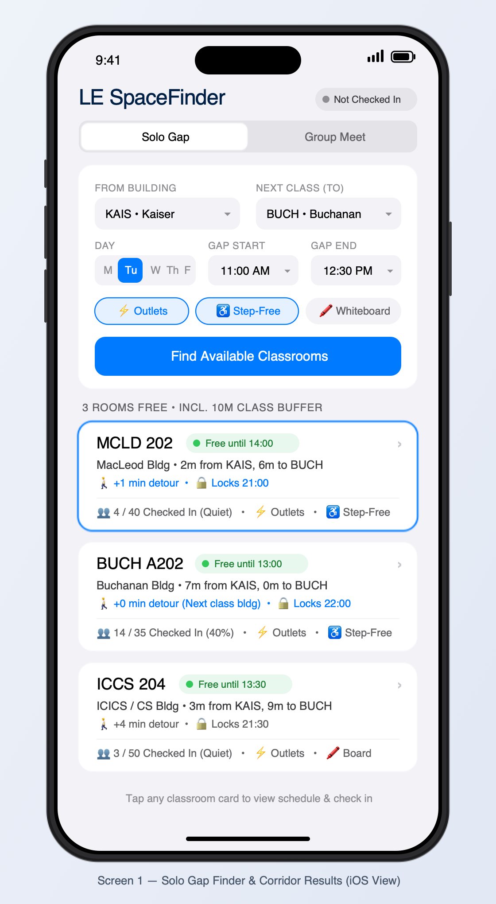
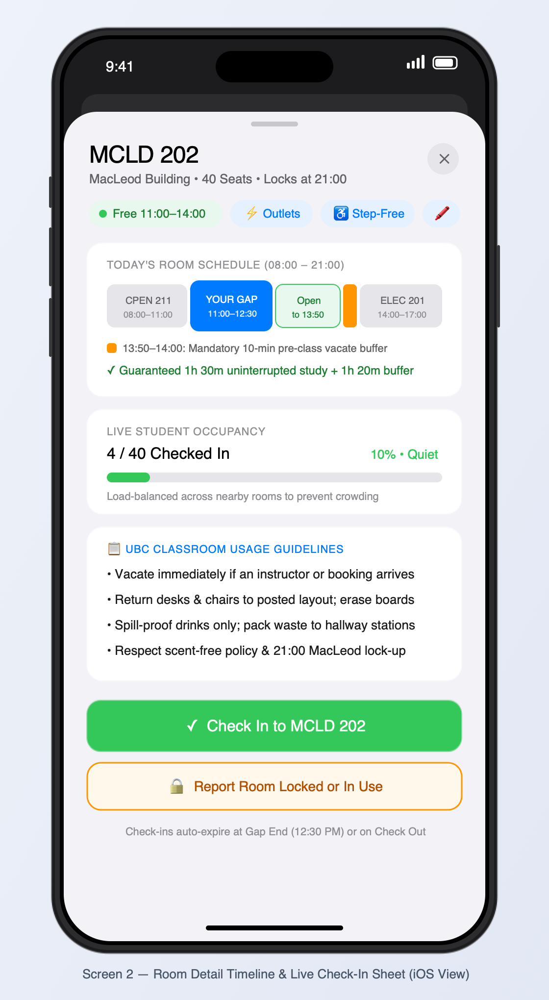
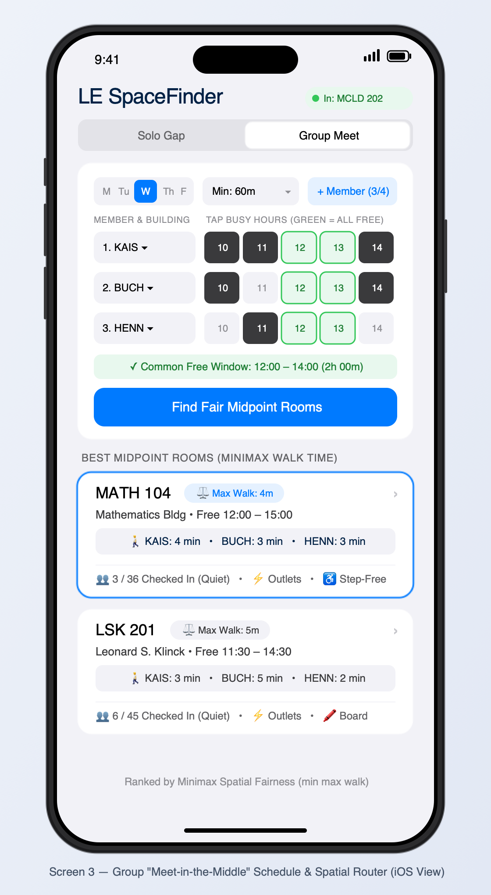

# CPEN 221A — Milestone 1: Design Specification

## 1. Design Your Team

* **Team Name:** LE — Learning Environments
* **Project Manager (PM):** Houze (Le) Guo
* **Designer:** Houze (Le) Guo
* **Developer:** Houze (Le) Guo

**Mission Statement:**
To eliminate daily campus friction for UBC students by transforming fragmented, hard-to-navigate institutional data into transparent, accessible tools for finding quiet, reliable places to study and collaborate between classes.

---

## 2. Design Your Solution

### Problem

#### Core Problem & Empirical Evidence
Across higher education campuses, access to functional informal learning space between scheduled lectures is a critical determinant of student academic productivity, sense of belonging, and well-being ([Pokorny et al., 2017](https://doi.org/10.1007/s10734-016-0063-3); [Regalado & Smale, 2015](https://doi.org/10.5860/crl.76.7.899)). At UBC Vancouver, over 60,000 students—more than 60% of whom commute ([AMS Academic Experience Survey](https://www.ams.ubc.ca/))—navigate a sprawling 400-hectare campus where central library seating (Irving K. Barber Learning Centre, Koerner Library, Woodward Library) and the AMS Nest consistently saturate during peak instructional hours (10:00 AM – 4:00 PM) ([Cha & Kim, 2015](https://doi.org/10.1016/j.acalib.2015.03.014)). Empirical literature in post-secondary spatial planning demonstrates why this bottleneck harms students and why unbooked classrooms represent an ideal, policy-sanctioned relief valve:

1. **Demand for Proximate "In-Between" Transition Spaces:** Harrop and Turpin ([2013](https://doi.org/10.1080/13614533.2013.740961)) found that students choosing study spaces during timetable gaps between lectures prioritize **proximity to their next scheduled class**, **guaranteed availability for a known duration**, and **access to power outlets and work surfaces** over traditional central library environments. When transition times between classes are tight, walking 10–15 minutes out of the way to a central library only to hunt for an open seat renders short study gaps unusable ([Regalado & Smale, 2015](https://doi.org/10.5860/crl.76.7.899)).
2. **Classroom Underutilization & Information Asymmetry:** Beyrouthy et al. ([2009](https://doi.org/10.1057/palgrave.jors.2602523)) demonstrated empirically across university campuses that general teaching classrooms sit unoccupied for a substantial portion of the instructional week due to scheduling fragmentation. Similarly, Beckers, van der Voordt, and Dewulf ([2016](https://doi.org/10.1080/07294360.2015.1123230)) showed that decentralized spaces inside academic buildings remain heavily underutilized for self-study and small-group collaboration because students lack real-time visibility into room availability and amenities.
3. **Institutional Permission vs. Fragmented Portals at UBC:** Official [UBC Learning Spaces Classroom Usage Guidelines](https://learningspaces.ubc.ca/useful-resources/guidelines/) explicitly state: *"Classrooms can be used as a study space when classes or other events are not in session,"* provided students vacate promptly before scheduled bookings, respect building lock-up hours (up to 11:00 PM in most buildings, or earlier in buildings like MacLeod at 9:00 PM), leave furniture in its posted layout, and pack out waste to hallway sorting stations. However, UBC's public timetable interfaces ([UBC Online Timetable](https://sws-van.as.it.ubc.ca/) and [UBC Learning Spaces](https://learningspaces.ubc.ca/find-a-space/)) only allow querying one course or one single room at a time, and fail to reflect real-time ground occupancy or early door lock-ups ([Azizi et al., 2020](https://doi.org/10.1016/j.buildenv.2020.107355)). There is no tool that inverts this index to query **by time window, walking corridor, and physical accessibility**.

#### Value Sensitive Design (VSD) & Stakeholder Considerations
Following Value Sensitive Design principles, our problem formulation accounts for both **direct stakeholders** (solo students and project groups seeking study spaces) and **indirect stakeholders** (instructors, custodial/facilities staff, and students with mobility disabilities):
* **Preventing Class Disruption (Instructors & Incoming Students):** Students studying in a room right up until the exact minute a lecture starts causes doorway congestion and setup delays for instructors. Any ethical classroom discovery system must enforce a mandatory **10-minute pre-class transition buffer** before the next scheduled lecture and respect building lock-up cutoffs.
* **Preventing Artificial Overcrowding ("The Waze Effect"):** If a room-finding app naively recommends the single highest-ranked empty room to 80 concurrent users in the same building, it will overwhelm that classroom and turn a quiet space into a noisy, overcrowded room. The system must incorporate **crowd-aware load balancing**.
* **Physical Accessibility:** Students using mobility aids cannot use rooms reachable only via stairs or lacking accessible seating; step-free access must be a first-class filter.

---

### Solution

#### Overview
**LE SpaceFinder** is a responsive, tap-driven client-server web application backed by a concurrent Java server that transforms static UBC classroom schedules and campus walkway topology into an intelligent, real-time study space router.

To guarantee fast, zero-typing usability between classes while walking across campus, **the application contains no sound and no keyboard support**—all inputs are operated exclusively via point-and-click / touch dropdowns, time-block pills, and toggle buttons, using the same responsive layout across mobile and desktop platforms.

#### Core Algorithmic & Architectural Functionality
1. **Temporal Interval Index (`IntervalTree`):** Each classroom's daily schedule is modeled as a set of occupied intervals $[t_{\text{start}}, t_{\text{end}})$ augmented with a mandatory **10-minute pre-lecture vacate buffer** and the building's specific **evening lock-up cutoff** (e.g., `21:00` for MacLeod, `23:00` campus default). A query for a student's arrival-to-departure window $[t_{\text{arrive}}, t_{\text{leave}}]$ returns only rooms that are continuously free across $[t_{\text{arrive}}, t_{\text{leave}} + 10\text{ min})$ and calculates the exact remaining free duration before the next class or lock-up.
2. **Spatial Corridor & Detour Router (`CampusGraph`):** Campus buildings are represented as nodes in a weighted undirected graph where edge weights represent walking time in minutes. Given a student's **Origin Building** $A$ (`From`) and **Destination Building** $B$ (`To`), the server computes shortest-path walking times $t_{\text{walk}}(A, R)$ and $t_{\text{walk}}(R, B)$ (Dijkstra's algorithm) and the **net walking detour**:
   $$\text{Detour}(R) = t_{\text{walk}}(A, R) + t_{\text{walk}}(R, B) - t_{\text{walk}}(A, B)$$
   Furthermore, the server verifies that $t_{\text{leave}} - t_{\text{arrive}} = (q_{\text{end}} - q_{\text{start}}) - t_{\text{walk}}(A, R) - t_{\text{walk}}(R, B) \ge 20\text{ min}$ of actual seated study time.
3. **Congestion-Aware Ranking & Live Check-Ins (Thread-Safe Server State):** Multiple concurrent users can tap **Check In** when they sit down in a room (or **Report Room Locked or In Use** if an unscheduled event is occurring). Eligible rooms are scored and ranked in descending order of utility:
   $$\text{Score}(R) = w_1 \cdot \min(\text{ExtraBufferMinutes}(R), 60) - w_2 \cdot \text{Detour}(R) - w_3 \cdot \left(\frac{\text{LiveCheckedIn}(R)}{\text{Capacity}(R)}\right)^2$$
   with weights $w_1 = 1$, $w_2 = 2$, and $w_3 = 30$. This quadratic congestion penalty automatically distributes concurrent users across nearby empty classrooms.
4. **Group "Meet-in-the-Middle" Minimax Optimizer:** For 2–4 teammates located in buildings $\{B_1, \dots, B_k\}$ with different busy class blocks, the server computes the **interval intersection** of all members' free blocks to find common meeting windows of at least $\Delta t_{\min}$ minutes, and ranks candidate rooms by **Minimax Spatial Fairness**:
   $$\min_{R} \max_{i \in \{1..k\}} t_{\text{walk}}(B_i, R)$$
   breaking ties by lowest total group walking time $\sum_i t_{\text{walk}}(B_i, R)$ and lowest congestion ratio.

---

#### User Interface Specification & Screen Mockups

The application consists of **3 screens/views** operated entirely by tap/click controls:

##### Screen 1: Solo Gap Finder & Corridor Results (Default View)

  

* **Purpose:** Allows an individual student to find the best available classroom along their walking corridor between two classes.
* **Interactive Controls (Tap/Click Only):**
  1. **Top Header & Status Pill:** Displays the application title (`LE SpaceFinder`) and the user's current check-in state (`Not Checked In` in gray, or `In: [Room Code]` in green when checked into a room).
  2. **Segmented Mode Switcher:** Switches between **`Solo Gap`** (active by default) and **`Group Meet`**.
  3. **`FROM BUILDING` Dropdown:** Select menu of UBC academic buildings alphabetically by code (`BUCH • Buchanan`, `HENN • Hennings`, `ICCS • ICICS/CS`, `KAIS • Kaiser`, `LSK • Klinck`, `MATH • Mathematics`, `MCLD • MacLeod`). Defaults to `KAIS • Kaiser`.
  4. **`NEXT CLASS (TO)` Dropdown:** Select menu of the same UBC academic buildings. Defaults to `BUCH • Buchanan`.
  5. **`DAY` Selector:** 5 tap pills (`M`, `Tu`, `W`, `Th`, `F`). Exactly one day is active at a time.
  6. **`GAP START` & `GAP END` Dropdowns:** 30-minute increment select menus from `08:00 AM` to `10:30 PM`.
  7. **Amenity Filter Chips:** Multi-select toggle pills for `⚡ Outlets`, `♿ Step-Free`, and `🖍️ Whiteboard`.
  8. **Primary Action Button:** **`[ Find Available Classrooms ]`**.
* **Results List View:**
  * Displays a section header (`[N] ROOMS FREE • INCL. 10M CLASS BUFFER`) followed by ranked **Classroom Cards** (up to 10 cards). Each card displays:
    * **Room Code** (e.g., `MCLD 202`) and **Guaranteed Free Window Badge** (`Free until 14:00`)
    * **Building Name & Walking Breakdown** (`MacLeod Bldg • 2m from KAIS, 6m to BUCH`)
    * **Net Detour & Lock-Up Cutoff** (`🚶 +1 min detour • 🔒 Locks 21:00`)
    * **Live Crowd & Amenity Footer** (`👥 4 / 40 Checked In (Quiet) • ⚡ Outlets • ♿ Step-Free`)
  * Tapping any classroom card opens **Screen 2 (Room Detail Timeline & Live Check-In Sheet)**.

---

##### Screen 2: Room Detail Timeline & Live Check-In Sheet

  

* **Purpose:** Provides full daily schedule transparency for a selected classroom, reminds students of official UBC classroom etiquette, and enables one-tap live occupancy check-in or lock reporting.
* **Visual Elements & Controls:**
  1. **Sheet Header:** Room title (`MCLD 202`), building name, total seat capacity (`40 Seats`), building lock-up cutoff (`Locks at 21:00`), status/amenity pills (`Free 11:00–14:00`, `⚡ Outlets`, `♿ Step-Free`, `🖍️`), and **`[ ✕ ]`** close button.
  2. **Today's Room Schedule Timeline (`08:00 – 21:00`):** Color-coded horizontal timeline bar showing scheduled lectures in gray (`CPEN 211 08:00–11:00`, `ELEC 201 14:00–17:00`), the student's selected gap window in blue (`YOUR GAP 11:00–12:30`), extra open time in green (`Open to 13:50`), and the **mandatory 10-minute pre-class vacate buffer** in orange (`13:50–14:00`).
  3. **Live Student Occupancy Card:** Displays the real-time checked-in count (`4 / 40 Checked In`), quietness badge (`10% • Quiet`), and a visual progress bar synchronized across connected clients.
  4. **Official UBC Classroom Usage Guidelines Card:** Concise checklist summarizing official rules from `learningspaces.ubc.ca`:
     * *Vacate immediately if an instructor or booking arrives.*
     * *Return desks & chairs to posted layout; erase boards.*
     * *Spill-proof drinks only; pack waste to hallway stations.*
     * *Respect scent-free policy & building lock-up time.*
  5. **Concurrent Action Buttons:**
     * **`[ ✓ Check In to MCLD 202 ]`:** Atomically increments the room's live occupancy counter on the server, updates the top status badge (`In: MCLD 202`), and toggles the button to **`[ 👋 Check Out ]`**. Check-ins automatically expire at the end of the student's gap window (or after 2 hours, whichever comes first). Checking into a new room automatically checks the user out of any previously checked-in room.
     * **`[ 🔒 Report Room Locked or In Use ]`:** Flags the classroom as unavailable for 60 minutes (or until the next scheduled lecture), removing it from active recommendations for all connected users.

---

##### Screen 3: Group "Meet-in-the-Middle" Schedule & Spatial Router

  

* **Purpose:** Enables 2 to 4 teammates scattered across campus to intersect their schedules without typing and find a centrally located classroom that minimizes the longest walk for any member.
* **Interactive Controls (Tap/Click Only):**
  1. **Day Selector Pills (`M`–`F`), Minimum Duration Dropdown (`Min: 30m`, `60m`, `90m`, `120m`), and **`[ + Member (k/4) ]`** Button:** Supports 2 to 4 teammates.
  2. **Member & Building Rows + Busy-Hour Matrix:**
     * Each row has a **Starting Building Dropdown** (`1. KAIS`, `2. BUCH`, `3. HENN`) and tap-to-toggle 1-hour blocks (`10`, `11`, `12`, `13`, `14`, etc.).
     * Tapping an hour block toggles that member between **Busy / In Class** (dark gray) and **Free** (light gray). Contiguous columns where **all teammates are simultaneously free** automatically highlight in green (`12`, `13`) and update the summary banner (`✓ Common Free Window: 12:00 – 14:00 (2h 00m)`).
  3. **Primary Action Button:** **`[ Find Fair Midpoint Rooms ]`**.
* **Group Results View:**
  * Lists **Ranked Midpoint Room Cards** ordered by **Minimax Spatial Fairness** ($\min_R \max_i t_{\text{walk}}(B_i, R)$):
    * **Room Code & Minimax Fairness Badge** (`MATH 104` • `⚖️ Max Walk: 4m`)
    * **Building & Free Window** (`Mathematics Bldg • Free 12:00 – 15:00`)
    * **Per-Member Walk Breakdown Pill** (`🚶 KAIS: 4 min • BUCH: 3 min • HENN: 3 min`)
    * **Live Occupancy & Amenities** (`👥 3 / 36 Checked In (Quiet) • ⚡ Outlets • ♿ Step-Free`)
  * Tapping any group room card opens **Screen 2**.

---

#### Complete Error States & Edge-Case Specifications

Every invalid input, empty query result, and concurrent conflict state is explicitly handled in the UI without crashes or ambiguous blank screens:

| Error / Edge Case Scenario | Trigger Condition | Exact UI Behavior & Visual Feedback |
| :--- | :--- | :--- |
| **1. Invalid Time Range (Solo Search)** | User selects `Gap End <= Gap Start`, or a total window shorter than `30 minutes`. | The `[ Find Available Classrooms ]` button disables (dims to muted gray) and an inline red alert banner appears directly below the time dropdowns: *"⚠️ Invalid time window: Gap End must be at least 30 minutes after Gap Start."* |
| **2. Walking Time Exceeds Gap Window** | Origin $A$ and Destination $B$ are so far apart relative to $[q_{\text{start}}, q_{\text{end}}]$ that $t_{\text{walk}}(A, R) + t_{\text{walk}}(R, B) + 20\text{ min study} > (q_{\text{end}} - q_{\text{start}})$. | Results area displays a yellow warning card: *"⏳ Tight Transit Warning: Walking from [Building A] to [Building B] takes [X] minutes, leaving less than 20 minutes to sit and study before your next class."* |
| **3. After-Hours / Building Locked Query** | User queries a time window after the selected buildings' lock-up cutoff (e.g., after `21:00` in MacLeod or `23:00` campus-wide). | Results area displays an informational lock card: *"🔒 Campus Classrooms Closed: UBC general teaching classrooms lock by 21:00–23:00 per UBC Learning Spaces policy."* |
| **4. Zero Classrooms Match Filters** | All rooms in the corridor are booked or lack the selected amenity combination (e.g., `Step-Free` + `Whiteboard`). | Results area displays an Empty State Card with a one-tap recovery button: *"No classrooms match all selected filters for this window. [ 🔄 Relax Amenity Filters ]"* which clears optional amenity toggles and re-runs the search. |
| **5. No Overlapping Group Free Window** | In Screen 3, the intersection of all teammates' free intervals contains no contiguous block $\ge \Delta t_{\min}$. | The summary banner turns red/amber and displays the closest partial match: *"⚠️ No [X]-minute window where all members are free. Best partial match: 13:00–14:00 (2 of 3 members free)."* |
| **6. Concurrent Check-In / Room Newly Locked** | User opens Screen 2 for a room, and while viewing it, another concurrent client flags the room as `Locked` or takes the final seat. | Tapping `[ ✓ Check In ]` displays an inline conflict alert inside the sheet: *"⚠️ Room Status Updated: Another student just reported this room locked or full. Please select another room."* and refreshes the room state. |
| **7. Duplicate Check-In Prevention** | A user who is already checked into Room $X$ taps `[ ✓ Check In ]` on Room $Y$. | The server atomically decrements Room $X$'s occupancy count, increments Room $Y$'s count, updates the top navigation status badge (`In: Room Y`), and displays: *"Switched active check-in from [Room X] to [Room Y]."* |

---

### References
1. **Azizi, S., Nair, G., Rabiee, R., & Olofsson, T. (2020).** Application of Internet of Things in academic buildings for space use efficiency using occupancy and booking data. *Building and Environment*, 186, 107355. https://doi.org/10.1016/j.buildenv.2020.107355
2. **Beckers, R., van der Voordt, T., & Dewulf, G. (2016).** Why do they study there? Diary research into students' learning space choices in higher education. *Higher Education Research & Development*, 35(1), 142–156. https://doi.org/10.1080/07294360.2015.1123230
3. **Beyrouthy, C., Burke, E. K., Landa-Silva, J. D., McCollum, B., McMullan, P., & Parkes, A. J. (2009).** Towards improving the utilisation of university teaching space. *Journal of the Operational Research Society*, 60(1), 130–143. https://doi.org/10.1057/palgrave.jors.2602523
4. **Cha, S. H., & Kim, T. W. (2015).** What matters for students' use of physical library space? *The Journal of Academic Librarianship*, 41(3), 274–279. https://doi.org/10.1016/j.acalib.2015.03.014
5. **Harrop, D., & Turpin, B. (2013).** A study exploring learners' informal learning space behaviors, attitudes, and preferences. *New Review of Academic Librarianship*, 19(1), 58–77. https://doi.org/10.1080/13614533.2013.740961
6. **Pokorny, H., Holley, D., & Kane, S. (2017).** Commuting, transitions and belonging: The experiences of students living at home in their first year at university. *Higher Education*, 74(3), 543–558. https://doi.org/10.1007/s10734-016-0063-3
7. **Regalado, M., & Smale, M. A. (2015).** "I am more productive in the library because it's quiet": Commuter students in the college library. *College & Research Libraries*, 76(7), 899–913. https://doi.org/10.5860/crl.76.7.899
8. **UBC Learning Spaces (2026).** *Classroom Usage Guidelines*. University of British Columbia. https://learningspaces.ubc.ca/useful-resources/guidelines/
